# RocaDex — Frontend

Aplicación móvil desarrollada con **Expo + React Native** para reconocer rocas a partir de una fotografía. Consume la API REST del proyecto **RocaDex** e incluye catálogo, reconocimiento con cámara o galería, colección personal, logros, progreso, retroalimentación y un panel de administración completo.

La app funciona en **Android, iOS y web** (Expo Web), con una interfaz mobile-first, navegación por pestañas, estados de carga/error/vacío y controles de accesibilidad.

---

## 1. Descripción

| Aspecto | Detalle |
| --- | --- |
| Nombre | RocaDex |
| Propósito | Identificar rocas, guardar descubrimientos y hacer seguimiento del aprendizaje |
| Roles | Administrador, usuario autenticado e invitado |
| Backend | API REST en `http://localhost:8080/api` |
| Plataformas | Android, iOS y web |

### Funcionalidades principales

- **Landing pública** con inicio de sesión, registro y acceso como invitado.
- **Sesión persistente** con SecureStore en nativo y `localStorage` en web; cierre de sesión con confirmación.
- **Catálogo** con búsqueda, filtros por tipo y categoría, paginación, estados vacío/error y detalle completo de cada roca.
- **Reconocimiento** desde cámara o galería, vista previa, validación de formato/tamaño, estados de procesamiento y resultado con enlace a la ficha.
- **Límite de invitado**: 10 reconocimientos por sesión, con contador visible y llamada a crear cuenta al alcanzar el límite.
- **Colección personal** de rocas descubiertas y **progreso** con estadísticas y logros.
- **Progreso temporal de invitado** con opción de migrarlo al registrarse o iniciar sesión.
- **Retroalimentación** del resultado por parte de usuarios autenticados.
- **Panel de administración** con estadísticas, usuarios/roles/estado, CRUD de rocas, tipos, categorías y logros, historial de reconocimientos y evaluaciones.
- **Confirmaciones** antes de acciones destructivas o sensibles.

---

## 2. Stack

- **Expo SDK 58** y **React Native 0.88**
- **Expo Router 58** (rutas basadas en archivos)
- **TypeScript** estricto
- **Axios** para la API REST
- **React Hook Form + Zod** para formularios y validación
- **Expo Camera** y **Expo Image Picker** para la captura de imágenes
- **Expo SecureStore** para persistir tokens
- **@expo/vector-icons** (Ionicons)
- **ESLint** con `eslint-config-expo`
- **Playwright Core** (solo para generar capturas de documentación)

---

## 3. Requisitos

- **Node.js 22 o superior**
- **npm**
- Backend de RocaDex en ejecución (ver más abajo)
- Para probar en dispositivo físico: el teléfono y el computador en la misma red Wi-Fi

---

## 4. Configuración y ejecución

### 4.1. Levantar el backend

Desde la carpeta `Backend`:

```powershell
npm ci
# Solo si no existe .env
Copy-Item .env.example .env
```

Completa en `Backend/.env` al menos `JWT_SECRET`, `ADMIN_PASSWORD` y `GEODEX_API_KEY`, y luego:

```powershell
npm start
# o, con recarga automática:
npm run dev
```

El backend queda disponible en `http://localhost:8080`. La documentación completa de la API está en `Backend/README.md`.

### 4.2. Levantar el frontend

Desde la carpeta `Frontend`:

```powershell
npm ci
Copy-Item .env.example .env
npm start
```

Luego abre la app con:

- `a` → Android (emulador o dispositivo)
- `i` → iOS (macOS)
- `w` → navegador web

También puedes usar directamente:

```powershell
npm run android
npm run ios
npm run web
```

### 4.3. Variables de entorno

El archivo `.env` admite una sola variable:

| Variable | Ejemplo | Descripción |
| --- | --- | --- |
| `EXPO_PUBLIC_API_URL` | `http://192.168.1.10:8080/api` | URL base de la API REST |

Si no se define, la app intenta reutilizar el host del servidor de Metro y el puerto `8080`. En emulador Android usa `http://10.0.2.2:8080/api` y en web `http://localhost:8080/api`.

> Para un dispositivo físico, define `EXPO_PUBLIC_API_URL` con la IP local de tu computador. `localhost` dentro del teléfono apunta al propio teléfono.

### 4.4. Cámara y galería

Los permisos se declaran en `app.json` mediante los plugins de `expo-camera` y `expo-image-picker`. Expo Go incluye ambos módulos; si agregas librerías con código nativo, necesitarás un development build:

```powershell
npx expo run:android
npx expo run:ios
# o en la nube:
npx eas-cli build --profile development
```

---

## 5. Estructura del proyecto

```text
Frontend/
├── app.json                 # Configuración de Expo, permisos y plugins
├── eslint.config.js         # Configuración ESLint (flat config)
├── tsconfig.json            # TypeScript estricto + alias @/*
├── .env.example             # Ejemplo de configuración de API
├── assets/                  # Íconos y recursos estáticos
├── docs/screenshots/        # Capturas usadas en este README
├── scripts/
│   └── capture-screenshots.mjs
└── src/
    ├── api/                 # Cliente Axios y módulos por recurso
    │   ├── axiosClient.ts   # Base URL, tokens e interceptor 401
    │   ├── storage.ts       # SecureStore / localStorage
    │   ├── authApi.ts
    │   ├── rockApi.ts
    │   ├── taxonomyApi.ts
    │   ├── recognitionApi.ts
    │   ├── collectionApi.ts
    │   ├── progressApi.ts
    │   ├── achievementApi.ts
    │   ├── feedbackApi.ts
    │   └── adminApi.ts
    ├── app/                 # Rutas de Expo Router
    │   ├── _layout.tsx      # Stack raíz y proveedores
    │   ├── index.tsx        # Landing pública
    │   ├── +not-found.tsx
    │   ├── (auth)/          # Login y registro
    │   ├── (tabs)/          # Home, catálogo, reconocer, colección, progreso, perfil
    │   ├── catalog/[id].tsx # Detalle de roca
    │   ├── feedback/[analysisId].tsx
    │   └── admin/           # Panel protegido por rol
    ├── components/
    │   ├── ui/              # Botones, cards, inputs, modales, estados, etc.
    │   ├── rocks/           # Tarjetas e imágenes de rocas
    │   ├── forms/           # Formularios RHF + Zod
    │   ├── recognition/     # Cámara y tarjeta de resultado
    │   ├── activity/        # Filas de historial
    │   └── admin/           # Gestor compartido de tipos/categorías
    ├── context/             # AuthContext y TaxonomyContext
    ├── hooks/               # useApiResource, usePaginatedList, etc.
    ├── theme/               # Colores, espaciados, tipografía y radios
    ├── types/               # Tipos de la API
    └── utils/               # Errores, formato e imágenes
```

---

## 6. Flujos principales

### 6.1. Acceso

1. La app abre la **landing** (`/`).
2. El usuario puede **iniciar sesión**, **crear una cuenta** o **explorar como invitado**.
3. Al autenticarse se consulta `GET /api/user/me` para obtener el rol y se redirige a `/home`.
4. Las rutas privadas redirigen a la landing si no hay sesión. El panel `/admin` exige rol `Admin`.

### 6.2. Invitado

1. `POST /api/guest/session` crea una sesión temporal (72 h por defecto).
2. El token se envía como `X-Guest-Token`.
3. El invitado puede ver catálogo, reconocer rocas (máximo 10) y consultar su progreso temporal.
4. Al registrarse o iniciar sesión se intenta migrar automáticamente el progreso del invitado.

### 6.3. Reconocimiento

1. Se elige **cámara** o **galería**.
2. Se valida que la imagen sea JPEG, PNG o WebP y que no supere **8 MB**.
3. Se envía `{ image: { base64, mime_type }, note? }` a `POST /api/recognition`.
4. La app muestra el resultado, los logros desbloqueados y accesos a la ficha de la roca y a la colección.
5. Si el invitado agota sus 10 intentos, el backend responde `403 GUEST_LIMIT_REACHED` y la app muestra la llamada a crear cuenta.

### 6.4. Administración

- **Resumen**: usuarios registrados, reconocimientos totales y ranking de rocas.
- **Usuarios**: búsqueda, detalle, cambio de rol, bloqueo/desbloqueo y consulta de colección/logros.
- **Rocas**: creación, edición y eliminación con confirmación.
- **Tipos y categorías**: CRUD mediante un gestor compartido.
- **Logros**: CRUD con condiciones automáticas y activación/desactivación.
- **Reconocimientos** y **retroalimentación**: listados paginados con filtros.

El administrador no puede bloquearse ni quitarse su propio rol; esas acciones se deshabilitan en la interfaz y el backend las rechaza.

---

## 7. Credenciales y procedimiento de prueba

### 7.1. Credenciales locales

La cuenta administradora se crea desde `Backend/.env`:

| Rol | Correo | Contraseña |
| --- | --- | --- |
| Administrador | `admin@example.test` | `u4-K-6Upg6L8_gopM5qRxCM3oGvfVaBm` |

> Estos valores corresponden al `.env` local de desarrollo. Cámbialos antes de desplegar. Si el backend usa otro `.env`, utiliza esas credenciales.

Para el rol **usuario autenticado**, crea una cuenta desde la app con `POST /api/user/registro`. No se requiere un usuario semilla adicional.

### 7.2. Procedimiento sugerido

1. **Invitado**
   - Abre la app y pulsa **Explorar como invitado**.
   - Revisa el catálogo, abre una roca y prueba los filtros.
   - Entra a **Reconocer**, elige una imagen y verifica el resultado.
   - Consulta **Colección**, **Progreso** y **Perfil**; observa el contador de intentos restantes.
   - Cierra la sesión de invitado desde el perfil.
2. **Registro y migración**
   - Como invitado, reconoce al menos una roca.
   - Crea una cuenta desde la llamada a la acción.
   - Verifica que el progreso temporal aparezca en la cuenta nueva.
3. **Usuario autenticado**
   - Inicia sesión, edita el perfil y envía retroalimentación desde el detalle de un reconocimiento.
   - Comprueba que la sesión persiste al recargar la app.
4. **Administración**
   - Inicia sesión con la cuenta admin y abre **Administración**.
   - Recorre usuarios, rocas, tipos, categorías, logros, reconocimientos y evaluaciones.
   - Prueba una acción destructiva y confirma que aparece el diálogo de confirmación.
5. **Errores**
   - Detén el backend y recarga una pantalla para ver los estados de error y el botón **Reintentar**.
   - Intenta iniciar sesión con credenciales incorrectas para ver el mensaje del backend.

---

## 8. Capturas

Las capturas se generaron con Expo Web y el script `scripts/capture-screenshots.mjs`.

| Landing | Invitado | Catálogo | Detalle de roca |
| --- | --- | --- | --- |
| 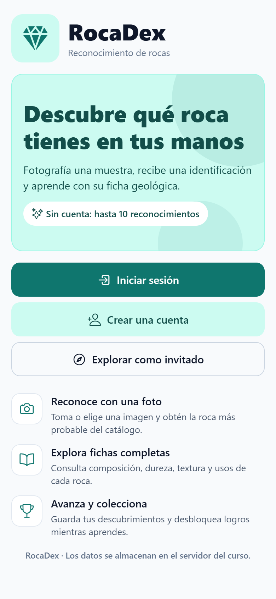 | 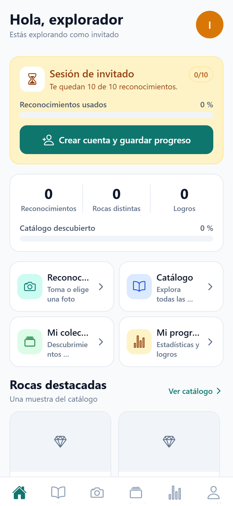 | 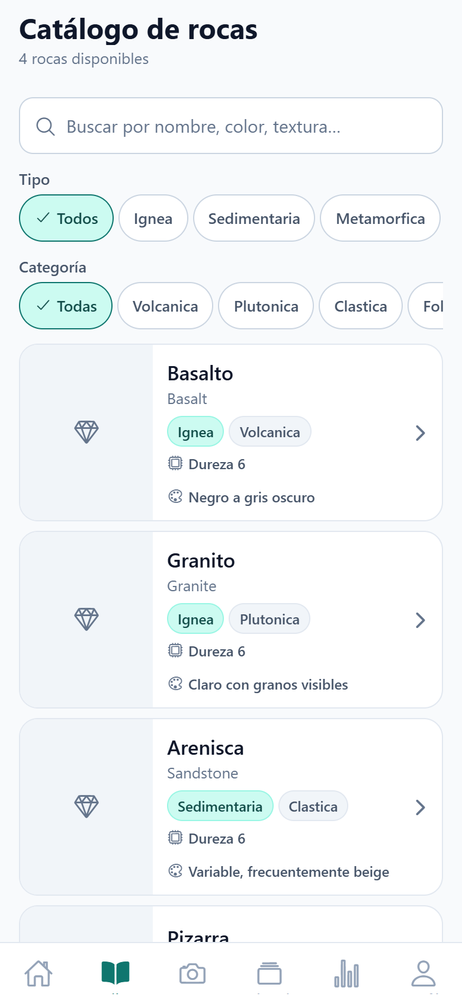 | 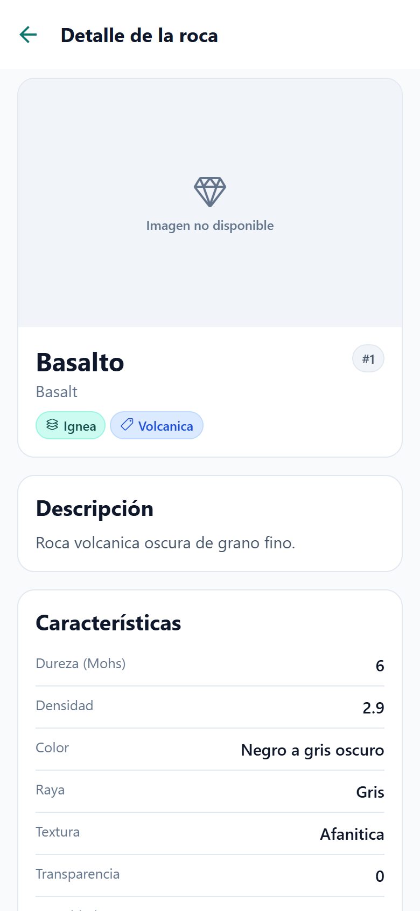 |

| Reconocer | Colección | Progreso | Perfil |
| --- | --- | --- | --- |
| 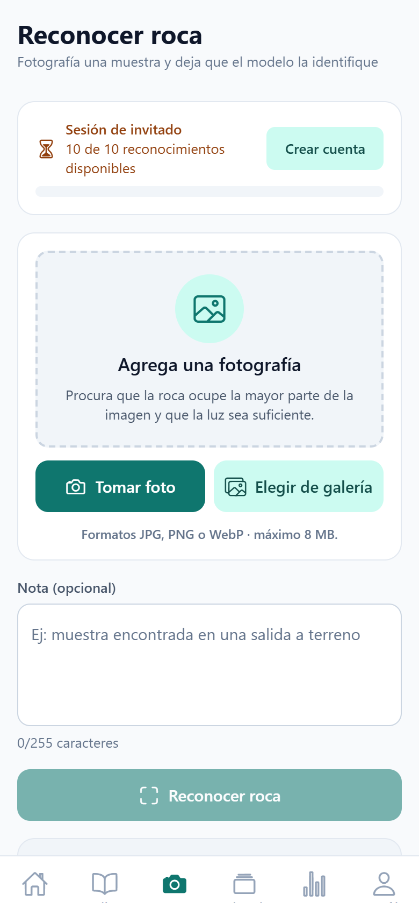 | 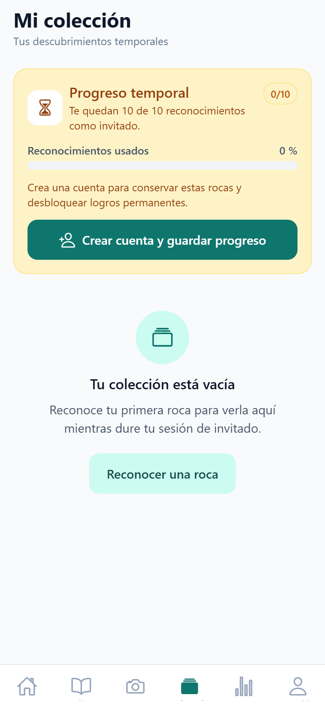 | 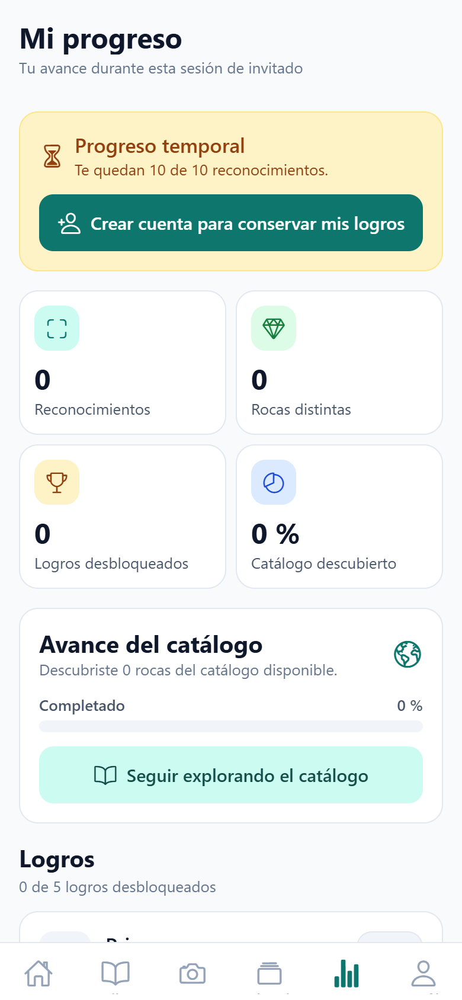 | 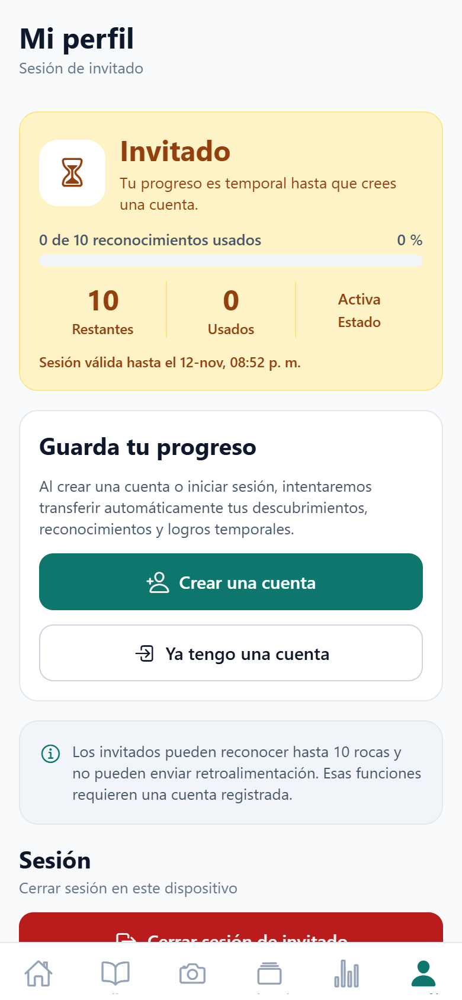 |

| Iniciar sesión | Registro | Panel admin | Usuarios |
| --- | --- | --- | --- |
| 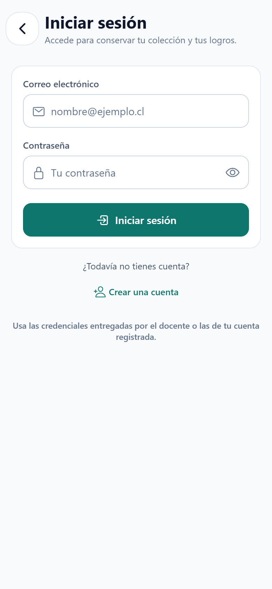 | 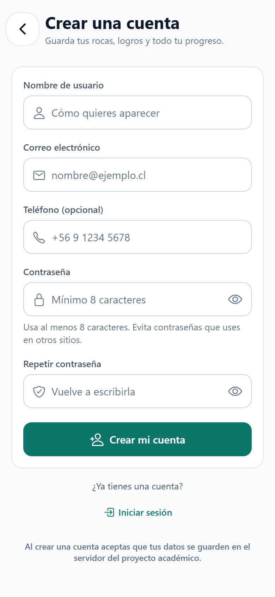 | 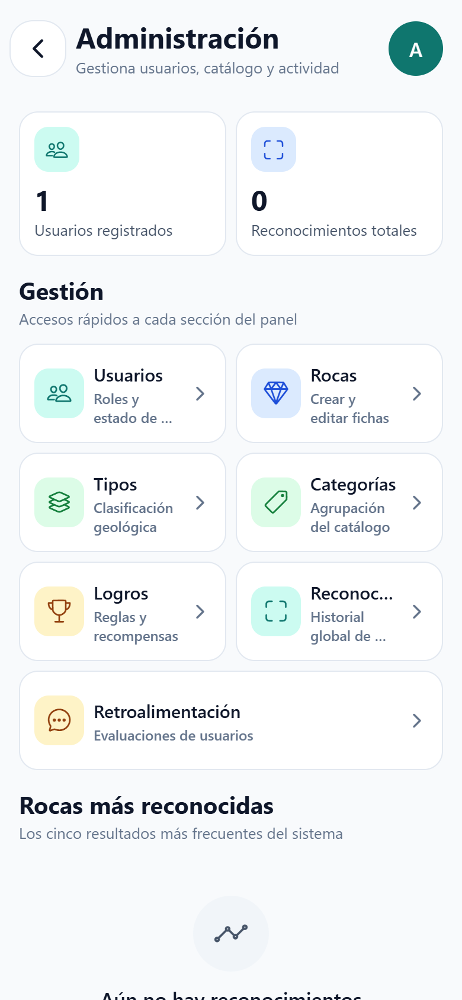 | 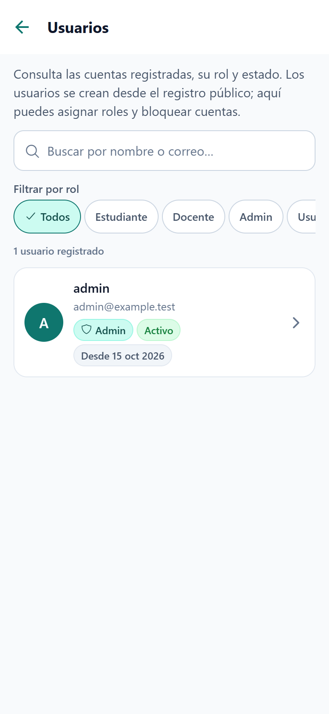 |

| Rocas | Tipos | Categorías | Logros |
| --- | --- | --- | --- |
| 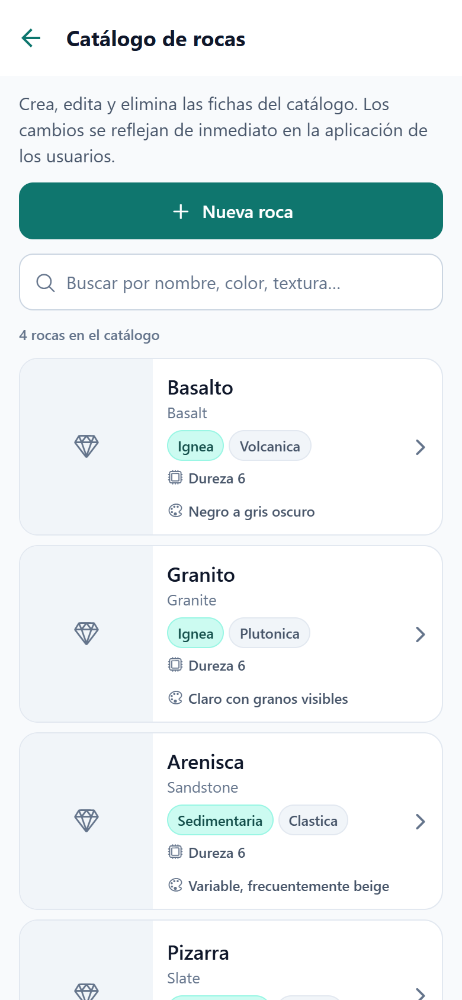 | 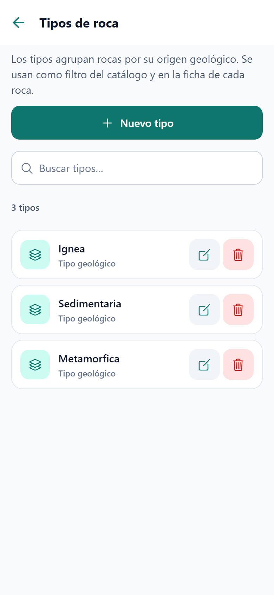 | 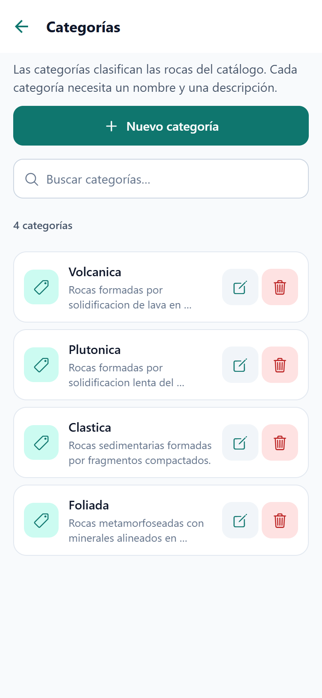 | 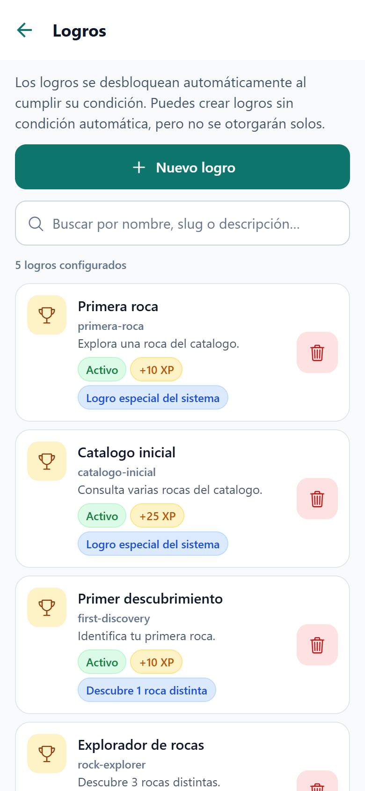 |

| Reconocimientos | Retroalimentación |
| --- | --- |
| 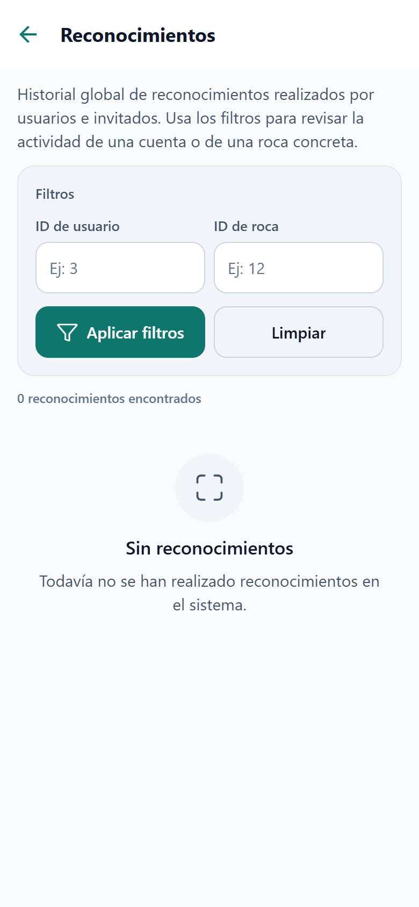 | 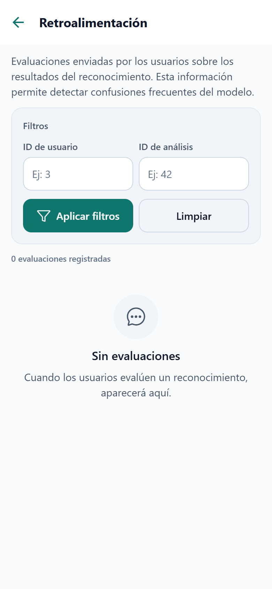 |

### Regenerar capturas

Con el backend y Expo Web en ejecución:

```powershell
$env:ADMIN_PASSWORD='tu-contraseña-admin'
npm run screenshots
```

El script usa Microsoft Edge en modo headless y guarda las imágenes en `docs/screenshots/`. Requiere `playwright-core` (incluido en `devDependencies`) y Edge instalado.

---

## 9. Calidad y verificación

```powershell
npx tsc --noEmit     # TypeScript estricto
npm run lint         # ESLint
npx expo-doctor      # Dependencias y configuración de Expo
```

Resultados esperados en este proyecto:

- `tsc --noEmit`: sin errores.
- `expo lint`: sin errores ni advertencias.
- `expo-doctor`: 20/20 verificaciones correctas.

Para comprobar el bundle de producción:

```powershell
npx expo export --platform android --no-bytecode
```

---

## 10. Accesibilidad y UX

- Etiquetas `accessibilityLabel`/`accessibilityHint` en controles interactivos.
- Roles semánticos (`button`, `link`, `tab`, `header`) y estados seleccionados.
- Objetivos táctiles de al menos 44–48 px.
- Contraste revisado en el tema teal/slate/amber.
- Los estados no dependen solo del color: incluyen texto e íconos.
- Manejo de teclado con `KeyboardAvoidingView`, `keyboardShouldPersistTaps` y cierre al desplazar.
- Safe areas mediante `react-native-safe-area-context`.
- Mensajes de error claros, con reintento cuando corresponde.

---

## 11. Funcionalidades implementadas

- [x] Landing pública con login, registro y acceso invitado.
- [x] Persistencia de sesión y cierre de sesión.
- [x] Rutas públicas/privadas y guardia de rol para administración.
- [x] Catálogo con búsqueda, filtros, paginación y detalle.
- [x] Reconocimiento desde cámara y galería con validación de imagen.
- [x] Resultado con enlace a la ficha, logros y retroalimentación.
- [x] Límite de invitado y llamada a crear cuenta.
- [x] Colección, progreso, logros y migración de invitado.
- [x] Perfil editable.
- [x] CRUD administrativo de rocas, tipos, categorías y logros.
- [x] Gestión de usuarios, roles y estado.
- [x] Estadísticas, reconocimientos y evaluaciones.
- [x] Confirmaciones en acciones destructivas.
- [x] Estados de carga, error, vacío y reintento.
- [x] Tema consistente y componentes reutilizables.

---

## 12. Limitaciones conocidas

- **Imágenes semilla**: algunas rocas del backend apuntan a `https://example.org/...`; la app muestra un marcador de posición con el nombre en lugar de una imagen rota.
- **Reconocimiento real**: depende de la clave, cuota y disponibilidad de GeoDex. Sin backend o sin clave, el flujo muestra el error correspondiente.
- **Capturas**: se generaron en Expo Web; en un dispositivo nativo la tipografía y las safe areas pueden variar ligeramente.
- **Carpetas nativas**: `ios/` y `android/` no se versionan (Continuous Native Generation). La configuración nativa vive en `app.json`.
- **Sin modo offline**: todas las pantallas requieren conexión con la API.
- **Retroalimentación administrativa**: el panel permite consultar y filtrar evaluaciones; no edita su contenido.
- **Límite de invitado**: es por sesión (10 reconocimientos), no por dispositivo ni por persona.
- **EAS**: no se incluye un `projectId` real; debes configurar tu propio proyecto con `eas init` antes de compilar en la nube.

---

## 13. Scripts disponibles

| Comando | Descripción |
| --- | --- |
| `npm start` | Inicia el servidor de desarrollo de Expo |
| `npm run android` | Abre la app en Android |
| `npm run ios` | Abre la app en iOS |
| `npm run web` | Abre la app en el navegador |
| `npm run lint` | Ejecuta ESLint |
| `npm run typecheck` | Ejecuta TypeScript sin emitir archivos |
| `npm run screenshots` | Regenera las capturas de documentación |

---

## 14. Notas de seguridad

- El token de sesión se guarda en SecureStore (nativo) o `localStorage` (web). No se registra en consola.
- Las credenciales nunca se envían al cliente; la clave de GeoDex permanece solo en el backend.
- El archivo `.env` está excluido de Git; usa `.env.example` como plantilla.
- La cuenta administradora de desarrollo debe cambiarse antes de publicar.
